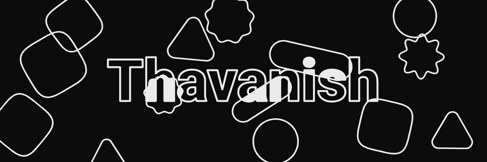

GitHub Stats

  

<table align="center">
  <tr>
    <td>
      
    </td>
    <td>
      
    </td>
  </tr>
</table>

About Me

### Hey, I'm Thavan

I'm a student developer interested in Android ROM development and low-level software engineering.

- **Currently working on:** Building LineageOS for an A12 device.
- **Main tools:** C, Makefiles, and tools used in Android ROM development.
- **Currently learning:** Kernel optimization and Android ROM building.
- **Interests:** Software development, drawing, volleyball, basketball, and football.
- **Other activities:** I practice two martial arts, including traditional martial arts and kung fu.
- **Future goals:** Get into a good university after high school and improve my focus on academics.

### Connect

- **Discord:** [Join my server](https://discord.gg/rmVETGuNx6)

